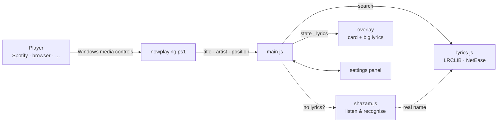

<div align="center">


# Lyrics Overlay

**Synced lyrics floating over your Windows desktop — for whatever is playing.**

Spotify · YouTube in Chrome, Edge, Firefox or Brave · any player in Windows' media controls

<p>
  
  
  
</p>

[Features](#features) · [Install](#install) · [Use it](#use-it) · [How it works](#how-it-works) · [Privacy](#privacy) · [License](#license)

</div>

---

##  Features

<table>
<tr>
<td width="50%" valign="top">

###  Now playing card
Cover, title, artist and a draggable progress bar, with play/pause and previous/next. The current lyric line underlines itself as it's sung, with the next lines below. Drag it anywhere, resize it, and hold **Ctrl** to make it fade away so you can click what's under it.

</td>
<td width="50%" valign="top">

###  Big floating lyrics
Lines that type in word by word, styled by mixing:
- **Look** — Depth (3D), Glow, Outline, Plain
- **Colour** — any colour, rainbow, a fade between two colours, or the cover art's colour
- **Motion** — Wave, Bounce, Pulse, Float, Flicker
- **Entrance** — Rise, Pop, Slide, Drop, Fade
- **Font**, size, width and position

</td>
</tr>
<tr>
<td valign="top">

###  Timing that fits
Lyrics come from [LRCLIB](https://lrclib.net), with other versions from LRCLIB and NetEase when the timing is off. Nudge a song earlier or later, or press **Sync** the moment a line is sung. Your fix is saved for that song.

</td>
<td valign="top">

###  Song recognition
When a video's title is too messy to find lyrics, the app can listen to a few seconds of what's playing and ask Shazam what the song really is, then search again with the real name.

</td>
</tr>
<tr>
<td valign="top">

###  Instant and offline
Lyrics found once are saved on disk, so a song loads instantly next time, even without internet.

</td>
<td valign="top">

###  Stays out of your way
A click-through window: everything except the card lets your clicks pass to the apps underneath. It doesn't pause YouTube, and goes fully idle when nothing is playing.

</td>
</tr>
</table>

##  Install

> Needs **Windows 10 or 11**.

### Installer

```bash
npm install
npm run dist
```

This makes `dist\Lyrics-Overlay-Setup-<version>.exe`. It installs for the current user, adds Start menu and desktop shortcuts, and can be removed from Windows' installed apps.

> [!NOTE]
> The installer isn't code-signed, so Windows shows *"Windows protected your PC"*. Click **More info → Run anyway**.

### Run from source

Needs [Node.js](https://nodejs.org). Double-click **`Start Lyrics Overlay.cmd`** (the first start installs Electron, which takes a minute), or:

```bash
npm install
npm start
```

##  Use it

Click the gear  on the card for settings, or right-click the tray icon.

| Shortcut | Does |
|:--|:--|
| <kbd>Ctrl</kbd> <kbd>Alt</kbd> <kbd>L</kbd> | Show or hide lyrics |
| <kbd>Ctrl</kbd> <kbd>Alt</kbd> <kbd>S</kbd> | Sync: press the moment the line on screen is sung |
| <kbd>Ctrl</kbd> <kbd>Alt</kbd> <kbd>↑</kbd> / <kbd>↓</kbd> | Lyrics earlier / later by 0.25 s |
| <kbd>Ctrl</kbd> <kbd>Alt</kbd> <kbd>O</kbd> / <kbd>P</kbd> | Next / previous lyrics version |
| <kbd>Ctrl</kbd> <kbd>Alt</kbd> <kbd>M</kbd> | Arrange: drag and resize the card and the lyrics |
| Hold <kbd>Ctrl</kbd> | Hide the card to click what's under it (Ctrl, Shift, Alt or off in settings) |

Settings live in `%APPDATA%\lyrics-overlay\settings.json`, saved lyrics in `%APPDATA%\lyrics-overlay\lyrics-cache`. **Reset all** in the settings puts everything back to the defaults.

##  How it works



| File | Role |
|:--|:--|
| `nowplaying.ps1` | Reads Windows' media controls (title, artist, position, cover) and reports changes |
| `lyrics.js` | Finds and scores timed lyrics; `cover.js` finds a cover on iTunes when the player shares none |
| `shazam.js` · `listen.*` | Records ~11 s of system audio, builds an audio fingerprint and asks Shazam for the song |
| `main.js` | The click-through overlay window, tray icon, shortcuts and settings |
| `overlay.*` · `settings.*` | Draws the card and big lyrics · the settings panel |

##  Privacy

No account, no tracking, no analytics. The app only talks to:

- **LRCLIB** and **NetEase** — song title, artist and length, to find lyrics
- **iTunes** — title and artist, to find a cover when the player shares none
- **Shazam** — only when *Recognise songs without lyrics* is on and no lyrics were found: an audio fingerprint of ~11 s of what's playing (not the audio itself)

> [!WARNING]
> Song recognition uses Shazam's unofficial, private service, the same way open-source apps like SongRec do. It can stop working at any time and isn't allowed by Shazam's terms. Turn it off under **Settings → Show**.

##  License

[GNU Affero General Public License v3.0 or later](LICENSE). You can use, change and share this app, but anything you build on it and share, or run for others over a network, must be released under the same license with its source code.

Lyrics belong to their artists and publishers and are fetched live from the services above; none are included here.
