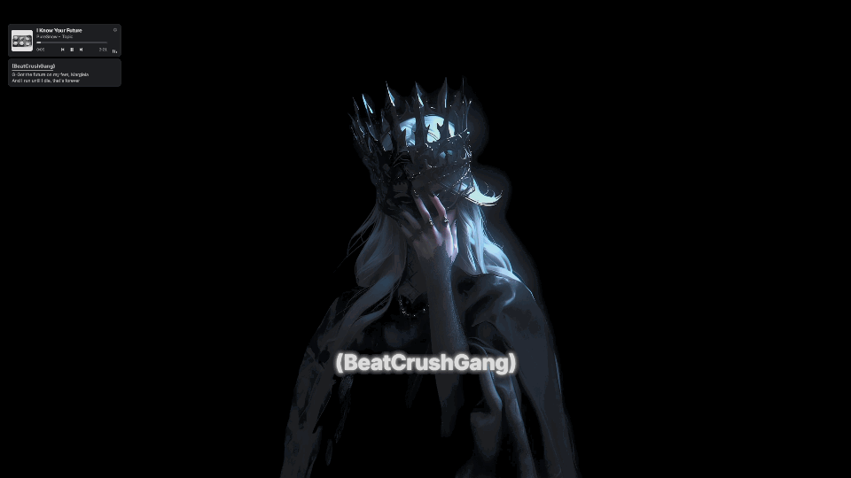
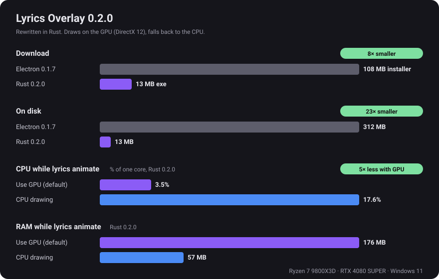
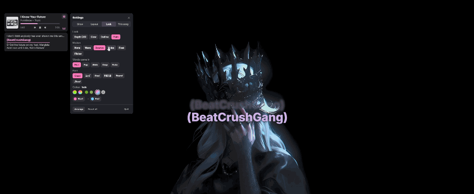
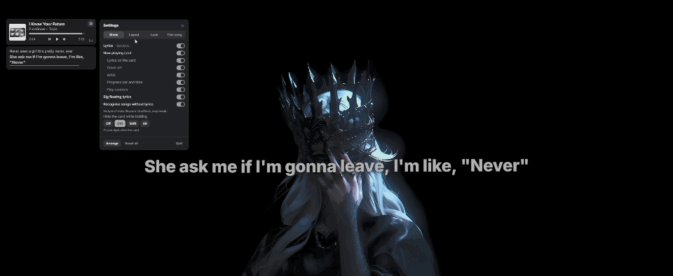
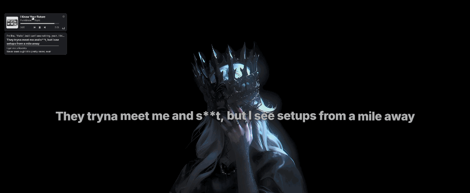
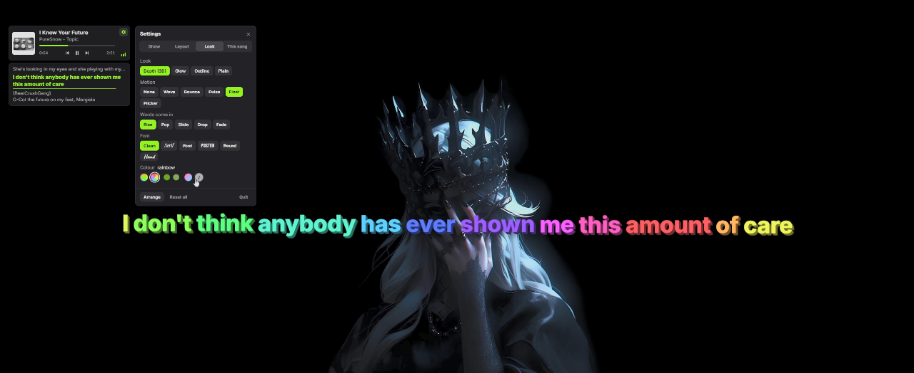
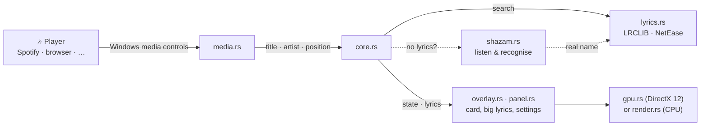

<div align="center">


# Lyrics Overlay

**Synced lyrics floating over your Windows desktop, for whatever is playing.**

Spotify · YouTube in Chrome, Edge, Firefox or Brave · any player in Windows' media controls

<p>
  
  
  
  
</p>

[Features](#-features) · [Faster in Rust](#-faster-in-rust) · [In action](#-in-action) · [Install](#-install) · [Use it](#-use-it) · [How it works](#-how-it-works) · [Privacy](#-privacy) · [License](#-license)

<br>



</div>

---

## ✨ Features

<table>
<tr>
<td width="50%" valign="top">

### 🎵 Now playing card
Cover, title, controls and the current lyric line. **Right-click** to hide it.<br>&nbsp;

</td>
<td width="50%" valign="top">

### 🔤 Big floating lyrics
Word-by-word lines. Mix looks, colours, motions and fonts.<br>&nbsp;

</td>
</tr>
<tr>
<td valign="top">

### 🎯 Timing that fits
Lyrics off? Nudge them or press **Sync**. Saved per song.<br>&nbsp;

</td>
<td valign="top">

### 🎧 Song recognition
Messy video title? It asks Shazam what's playing.<br>&nbsp;

</td>
</tr>
<tr>
<td valign="top">

### 💾 Instant and offline
Lyrics are saved, so songs load instantly, even offline.<br>&nbsp;

</td>
<td valign="top">

### 🖱️ Stays out of your way
Clicks pass through to the apps underneath.<br>&nbsp;

</td>
</tr>
<tr>
<td valign="top">

### ⚡ Light and fast
One 13 MB file, written in Rust, drawn with DirectX 12.<br>&nbsp;

</td>
<td valign="top">

### 🔄 Updates itself
One click to update. No installer.<br>&nbsp;

</td>
</tr>
</table>

## ⚡ Faster in Rust

Version 0.2.0 is a rewrite of the app in Rust. It does the same things as the Electron version it replaces, in a fraction of the space.



Drawing on the graphics card uses about 5× less CPU while lyrics move, but loads the graphics driver, which takes more memory. Prefer low memory? Turn off **Use GPU** under **Settings → Show**.

## 🎬 In action


<p align="center"><sub>Change the look live: colours, fonts, motion</sub></p>


<p align="center"><sub><b>Arrange</b>: resize the lyrics and put them anywhere</sub></p>


<p align="center"><sub>Drag the card, it snaps to lines and a grid</sub></p>


<p align="center"><sub>Depth (3D) look with rainbow colour</sub></p>

## 📦 Install

> Needs **Windows 10 or 11**.

### Download

1. Grab **`lyrics-overlay.exe`** from the [latest release](https://github.com/AhPlace2/lyrics-overlay/releases/latest).
2. Put it in a folder you'll keep, for example `%LOCALAPPDATA%\Programs\Lyrics Overlay`. Updates replace the file in place, so the folder must be one you can write to (not *Program Files*).
3. Double-click it. To start it from the Start menu, right-click it → **Pin to Start**.

There's no installer: to remove it, quit it from the tray icon and delete the file.

> [!NOTE]
> The app isn't code-signed, so Windows shows *"Windows protected your PC"*. Click **More info → Run anyway**.

> [!TIP]
> **Coming from 0.1.7 (Electron)?** Uninstall *Lyrics Overlay* from Windows' installed apps, then start the new one. Your settings, timing fixes and saved lyrics are kept.

### Build it yourself

Needs [Rust](https://rustup.rs).

```bash
cd native
cargo build --release
```

The app is `native\target\release\lyrics-overlay.exe`. For a CPU-only build without DirectX 12 (about 3 MB smaller), use `cargo build --release --no-default-features`.

### The old Electron version

The Electron app (0.1.7 and older) has been removed from this branch. Its code is still under the [`v0.1.7` tag](https://github.com/AhPlace2/lyrics-overlay/tree/v0.1.7). It won't get new features.

## 🎛️ Use it

Click the ⚙️ gear on the card for settings, or right-click the tray icon.

| Shortcut | Does |
|:--|:--|
| <kbd>Ctrl</kbd> <kbd>Alt</kbd> <kbd>L</kbd> | Show or hide lyrics |
| <kbd>Ctrl</kbd> <kbd>Alt</kbd> <kbd>S</kbd> | Sync: press the moment the line on screen is sung |
| <kbd>Ctrl</kbd> <kbd>Alt</kbd> <kbd>↑</kbd> / <kbd>↓</kbd> | Lyrics earlier / later by 0.25 s |
| <kbd>Ctrl</kbd> <kbd>Alt</kbd> <kbd>O</kbd> / <kbd>P</kbd> | Next / previous lyrics version |
| <kbd>Ctrl</kbd> <kbd>Alt</kbd> <kbd>M</kbd> | Arrange: drag and resize the card and the lyrics |
| Right-click the card | Hide it to click what's under it (or hold Ctrl, Shift or Alt, set in settings) |

Settings live in `%APPDATA%\lyrics-overlay\settings.json`, saved lyrics in `%APPDATA%\lyrics-overlay\lyrics-cache`. **Reset all** in the settings puts everything back to the defaults.

Under **Settings → Show**:
- **Use GPU** (on): draw with DirectX 12. Off draws on the CPU, which uses less memory but more CPU.
- **Check for updates** (on): look for a new version on GitHub once a day.

## 🔧 How it works



The overlay is one see-through window drawn with [egui](https://github.com/emilk/egui). Everything except the card and the settings lets clicks pass through to the apps underneath.

```
native/src/
├── main.rs      the window, tray icon, shortcuts, and picking the GPU or CPU renderer
├── core.rs      settings, what's playing, lyrics, timing fixes, the settings' actions
├── media.rs     reads Windows' media controls (title, artist, position, cover)
├── lyrics.rs    finds and scores timed lyrics
├── cover.rs     finds a cover on iTunes when the player shares none
├── listen.rs    records ~11 s of what the PC is playing, for song recognition
├── shazam.rs    turns audio into a fingerprint and asks Shazam for the song
├── update.rs    checks GitHub for a new version and swaps the exe
├── overlay.rs   the card and the big lyrics on screen
├── panel.rs     the settings panel
├── draw.rs      text, shadows, icons and animation helpers
├── gpu.rs       draws on the graphics card (DirectX 12)
├── render.rs    draws on the CPU, the fallback
├── fonts.rs     the built-in fonts, plus Windows' fonts for other scripts
├── colour.rs    colour maths
└── winutil.rs   small Windows calls: window styles, keys, one running copy
```

## 🔒 Privacy

No account, no tracking, no analytics. The app only talks to:

- **LRCLIB** and **NetEase:** song title, artist and length, to find lyrics
- **iTunes:** title and artist, to find a cover when the player shares none
- **Shazam:** an audio fingerprint of ~11 s of what's playing (not the audio itself), only when *Recognise songs without lyrics* is on and no lyrics were found
- **GitHub:** once a day, which version is the newest, only when *Check for updates* is on. Like any website, GitHub sees your IP address.

> [!WARNING]
> Song recognition uses Shazam's unofficial, private service, the same way open-source apps like SongRec do. It can stop working at any time and isn't allowed by Shazam's terms. Turn it off under **Settings → Show**.

## 📄 License

[GNU Affero General Public License v3.0 or later](LICENSE). You can use, change and share this app, but anything you build on it and share, or run for others over a network, must be released under the same license with its source code.

Lyrics belong to their artists and publishers and are fetched live from the services above; none are included here.
